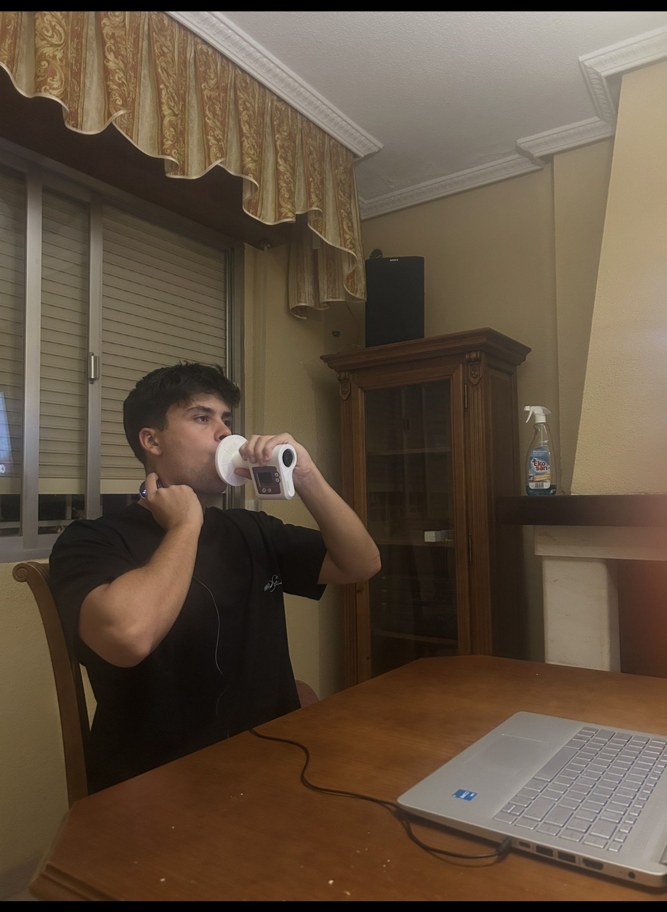
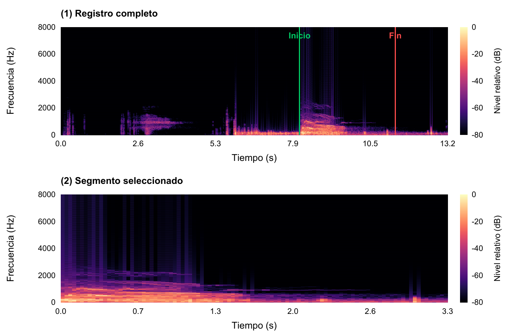
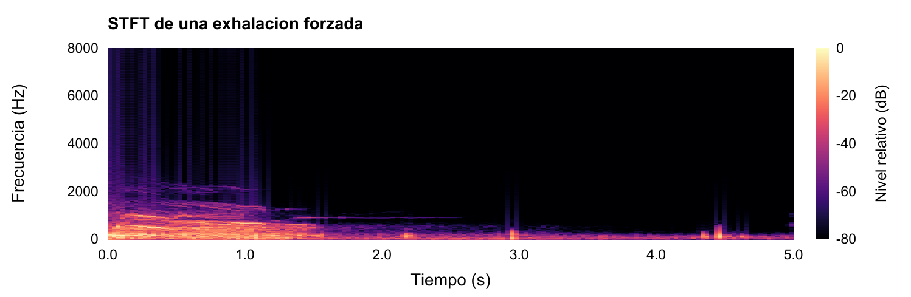
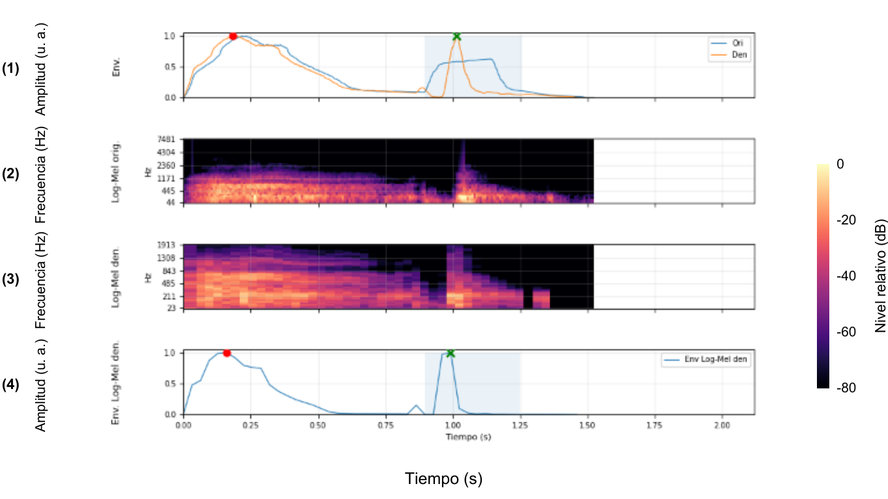
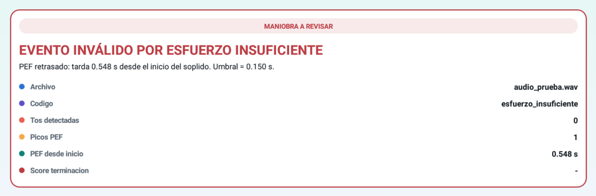

# Detección de la validez de una prueba espirométrica mediante el análisis de señales sonoras de exhalaciones forzadas

**Trabajo Fin de Grado** · Grado en Ingeniería de Tecnologías de Telecomunicación  
**Universidad de Jaén** · Escuela Politécnica Superior de Linares  
**Autor:** Carlos Chica Extremera  
**Tutores:** Francisco Jesús Cañadas Quesada y Alejandro Antonio Salvador Navarro  
**Año:** 2026

Este repositorio contiene la memoria, la base de señales acústicas y el software desarrollados para estudiar la aceptabilidad de maniobras espirométricas de exhalación forzada. El sistema identifica eventos acústicos compatibles con tos, esfuerzos múltiples, esfuerzo insuficiente y terminación precoz. Su resultado es una clasificación de apoyo basada en el sonido; no sustituye la evaluación clínica ni la inspección de las curvas espirométricas.

**Acceso a los materiales:** [Memoria (PDF)](memoria/memoria.pdf) · [Descargar memoria](https://github.com/cce00023-collab/Deteccion-de-la-validez-de-una-prueba-espirometrica-con-senales-sonoras-de-exhalaciones-forzadas/raw/refs/heads/main/memoria/memoria.pdf) · [Señales WAV](audios_metrica/) · [Inventario](inventario.csv) · [Aplicación Android (APK)](software/android/aplicacion_android.apk) · [Software de escritorio](software/escritorio/)

## Base de señales

La base de datos se basa en grabaciones de un único participante sano, cuyo estado de salud se confirmó antes de la adquisición y que no presentaba patologías previas conocidas. Reúne **125 archivos WAV**, distribuidos en cinco clases de 25 registros. Cada archivo representa una maniobra o un segmento de maniobra; el número de archivos no corresponde al número de participantes.

| Directorio | Archivos | Criterio de clasificación |
| --- | ---: | --- |
| [`audios_metrica/sanos/`](audios_metrica/sanos/) | 25 | Maniobras consideradas acústicamente aceptables en la referencia del trabajo. La etiqueta `sano` no constituye un diagnóstico del participante. |
| [`audios_metrica/tos/`](audios_metrica/tos/) | 25 | Maniobras que contienen al menos un evento de tos. |
| [`audios_metrica/multiple/`](audios_metrica/multiple/) | 25 | Maniobras con más de un esfuerzo espiratorio distinguible. |
| [`audios_metrica/esfuerzo_insuficiente/`](audios_metrica/esfuerzo_insuficiente/) | 25 | Maniobras con inicio o esfuerzo insuficiente, asociado en el análisis a un pico acústico retrasado. |
| [`audios_metrica/precoz/`](audios_metrica/precoz/) | 25 | Maniobras con terminación anticipada de la exhalación. |

Los nombres siguen el patrón `<clase><número>_S.wav`. Los prefijos son `sano`, `tos`, `esfmult`, `esfinsuf` y `precoz`; el número identifica un archivo dentro de su clase y no a una persona ni al orden de adquisición. Por ejemplo, `esfmult7_S.wav` corresponde al registro 7 de esfuerzo múltiple. El sufijo `_S` identifica la señal del estetoscopio. En las pruebas con otras fuentes se emplearon `_PC` para el micrófono del ordenador y `_M` para el móvil, pero esos registros no forman parte de la base publicada.

## Adquisición y características técnicas

Las grabaciones se obtuvieron entre abril y septiembre de 2026. Se registraron exhalaciones forzadas y se reprodujeron intencionadamente los eventos de ejecución estudiados. El participante permaneció sentado y con el tronco erguido. Se colocó un estetoscopio digital **Thinklabs One** en el cuello, procurando mantenerlo estable para reducir artefactos de contacto; durante las maniobras se utilizó un espirómetro **CONTEC SP-10**.

La captura original del estetoscopio se realizó en WAV monocanal, PCM de 16 bits y a **16 000 Hz**. El programa de adquisición permitía registrar simultáneamente el estetoscopio y el micrófono del ordenador. También se ensayó un móvil en pruebas preliminares. La base aquí distribuida contiene solo señales de estetoscopio. Para consultar las propiedades efectivas de cada WAV, incluidas su frecuencia de muestreo, codificación, número de muestras y duración, debe utilizarse [`inventario.csv`](inventario.csv).

El tamaño conjunto de los 125 WAV es de aproximadamente **14,22 MB**. El inventario también recoge la clase, el número de canales, el tamaño en bytes y el resumen SHA-256 de cada archivo. Las duraciones se obtienen del número de muestras y de la frecuencia indicada en la cabecera. Los archivos publicados se copiaron del paquete de documentación sin aplicar modificaciones adicionales durante la preparación del repositorio.

<p align="center"></p>
<p align="center"><em>Adquisición simultánea con espirómetro y estetoscopio digital. Imagen incluida en la memoria.</em></p>

## Procesamiento y clasificación

El análisis selecciona el segmento útil de la grabación, aplica una reducción controlada de ruido y remuestrea la señal a **4 kHz** para trabajar sobre una banda común. A partir de la señal procesada se calculan la envolvente temporal, la transformada de Fourier de tiempo corto (STFT) y las representaciones Mel y Log-Mel. El máximo principal de la envolvente se denomina pico acústico $PEF_a$; es una referencia de amplitud relativa, no una medida de flujo espiratorio.

<p align="center"></p>
<p align="center"><em>Recorte del segmento útil de una grabación real: arriba, registro completo; abajo, exhalación seleccionada.</em></p>

La decisión sigue una regla jerárquica: primero se evalúan los eventos de tos y los esfuerzos múltiples; después, el posible retraso del pico acústico y las características del final de la exhalación. Si no se detecta un criterio acústico de invalidez, la maniobra se clasifica como aceptable desde el punto de vista acústico. En la evaluación descrita en la memoria, 106 de las 125 clasificaciones coincidieron con la referencia, lo que corresponde a una exactitud global del **84,80 %**. Este resultado no equivale a una validación clínica independiente.

<p align="center"></p>
<p align="center"><em>Representación STFT de una exhalación forzada empleada en la memoria.</em></p>

<p align="center"></p>
<p align="center"><em>Análisis de una maniobra con tos: el transitorio aparece marcado en la envolvente y en las representaciones Log-Mel.</em></p>

## Organización del repositorio

```text
audios_metrica/          125 señales WAV, separadas en cinco clases
figuras/                 imágenes de la memoria reproducidas en este README
inventario.csv           características técnicas de cada WAV
memoria/memoria.pdf      memoria del TFG
software/android/        aplicación Android
software/escritorio/     programas Python de grabación y análisis
```

Los criterios de análisis se definieron a partir de una revisión bibliográfica amplia y de consultas de los tutores con neumólogos, con el objetivo de aproximar la interpretación de los patrones acústicos a las incidencias de ejecución relevantes en la práctica clínica. Estas consultas orientaron el diseño, pero no constituyen una validación clínica del clasificador: las etiquetas son categorías de trabajo, no diagnósticos ni anotaciones independientes de especialistas. Tampoco se incluyen curvas espirométricas sincronizadas que permitan verificar por sí solas la aceptabilidad clínica de cada maniobra.

## Software

El programa principal [`script.py`](software/escritorio/script.py) permite analizar uno o dos WAV y guardar los resultados. [`script_auxiliar.py`](software/escritorio/script_auxiliar.py) analiza un WAV con selección explícita de la fuente de captura; sus salidas no deben confundirse con las métricas históricas de la memoria. [`record_v3.py`](software/escritorio/record_v3.py) registra las entradas del estetoscopio y del micrófono del ordenador.

Para ejecutar los programas de escritorio en Windows se requiere Python 3.10 con Tkinter. Desde `software/escritorio/`:

```powershell
py -3.10 -m pip install -r requirements.txt
py -3.10 script.py
```

La [aplicación Android](software/android/aplicacion_android.apk) analiza un WAV local; no graba audio. Requiere Android 7.0 o superior y un dispositivo compatible con aplicaciones de 32 bits.

<p align="center"></p>
<p align="center"><em>Resultado de clasificación en la aplicación Android, con la clase asignada y los indicadores utilizados para revisarla.</em></p>

## Acceso

El repositorio es público. Los archivos pueden consultarse sin iniciar sesión o descargarse en conjunto mediante **Code > Download ZIP**, sin solicitar autorización ni contactar con la persona responsable. Si GitHub no muestra la vista previa de la memoria, utilice el [enlace de descarga directa](https://github.com/cce00023-collab/Deteccion-de-la-validez-de-una-prueba-espirometrica-con-senales-sonoras-de-exhalaciones-forzadas/raw/refs/heads/main/memoria/memoria.pdf). No se ha asignado una licencia de reutilización al material.
